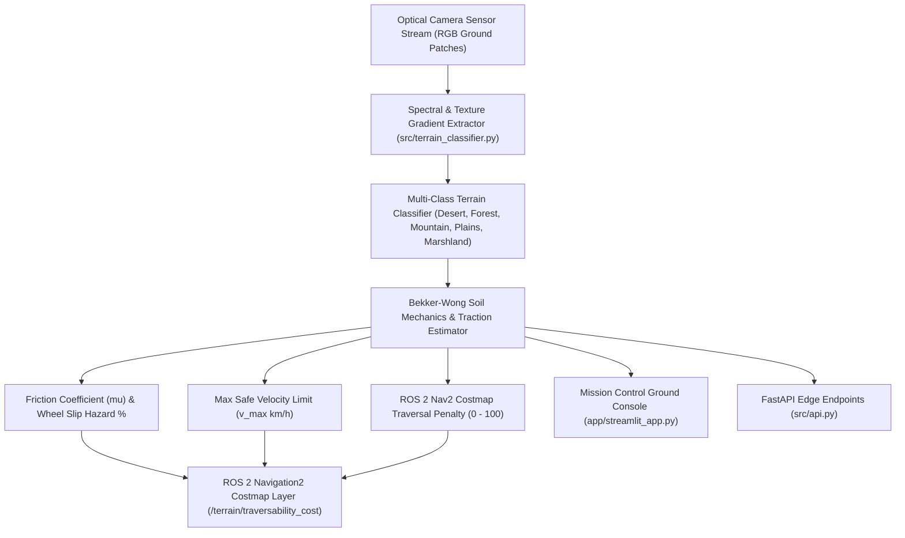

# Autonomous UGV Vision-Based Terrain Classification & Traversability Telemetry

[](https://vision-based-terrain-classification-bfzfgwhcu8npbf6lyipfyh.streamlit.app/)


An optical computer vision and soil mechanics telemetry system designed for unmanned ground vehicles (UGVs), field rovers, and outdoor robotics. It classifies terrain patches in real time, computes surface friction coefficients ($\mu$), quantifies wheel sinkage risk, and generates traversability costmaps for autonomous navigation stacks.

---

## Architecture Flow



---

## Autonomous Robotics & Industrial Use Case

In outdoor robotics (planetary exploration rovers, autonomous agricultural harvesters, construction site UGVs, search-and-rescue robots), standard geometric obstacle detection (e.g. LiDAR point clouds) fails to determine whether flat ground is traversable. A level surface of soft sand, deep mud, or loose gravel can immobilize or flip a rover.

This platform bridges vision perception and physical locomotion:
1. **Soil Mechanics & Friction Attribution**: Calculates surface friction coefficients ($\mu$) ranging from 0.22 (waterlogged marsh) to 0.72 (compact soil) to calibrate vehicle motor torque.
2. **Dynamic Velocity Throttling**: Automatically enforces linear speed limits ($v_{\max}$) to prevent rollover on steep mountain scree or chassis sinkage in desert dunes.
3. **ROS 2 Nav2 Costmap Injection**: Translates optical classifications into continuous traversal costs (0-100) consumable by global and local A*/Dijkstra path planners.

---

## Terrain Specifications & Soil Mechanics

| Terrain Class | Primary Characteristics | Friction Coeff ($\mu$) | Sinkage Risk (%) | Max Velocity ($v_{\max}$) | Nav2 Costmap Cost | Navigational Action |
|:---|:---|:---:|:---:|:---:|:---:|:---|
| **Plains** | Grassland, compact topsoil | 0.72 | 15% | 28.0 km/h | 20 / 100 | `NORMAL_CRUISE` |
| **Forest** | Dense leaf litter, hidden root obstacles | 0.58 | 45% | 14.0 km/h | 60 / 100 | `THROTTLE_DRIVE` |
| **Mountain** | Rocky scree, steep slope, loose stone | 0.52 | 35% | 8.0 km/h | 85 / 100 | `ENGAGE_DIFF_LOCK` |
| **Desert** | Granular sand dunes, loose dry sediment | 0.38 | 75% | 12.0 km/h | 70 / 100 | `THROTTLE_AND_MOMENTUM` |
| **Marshland** | Saturated silt, mud, standing water | 0.22 | 90% | 5.0 km/h | 98 / 100 | `HAZARDOUS_REROUTE` |

---

## API Endpoints

### 1. Health Verification
```http
GET /health
```
Response:
```json
{
  "status": "healthy",
  "service": "vision-based-terrain-classification",
  "supported_classes": ["Plains", "Desert", "Mountain", "Forest", "Marshland"]
}
```

### 2. Terrain Physical Profiles
```http
GET /api/v1/profiles
```

### 3. Classify Image File Upload
```http
POST /api/v1/classify/upload
Content-Type: multipart/form-data

file: [binary image file]
```

### 4. Classify Base64 Image Stream
```http
POST /api/v1/classify/base64
Content-Type: application/json

{
  "image_base64": "data:image/jpeg;base64,/9j/4AAQSkZJRg..."
}
```

---

## Local Setup & Development

### 1. Environment Installation
```bash
git clone https://github.com/MuhammadMinhaj229/Vision-Based-Terrain-Classification.git
cd Vision-Based-Terrain-Classification
pip install -r requirements.txt
```

### 2. Run Test Suite
```bash
python -m pytest tests/
```

### 3. Launch Mission Control Console
```bash
streamlit run app/streamlit_app.py
```

### 4. Launch FastAPI REST Server
```bash
uvicorn src.api:app --host 0.0.0.0 --port 8000 --reload
```
